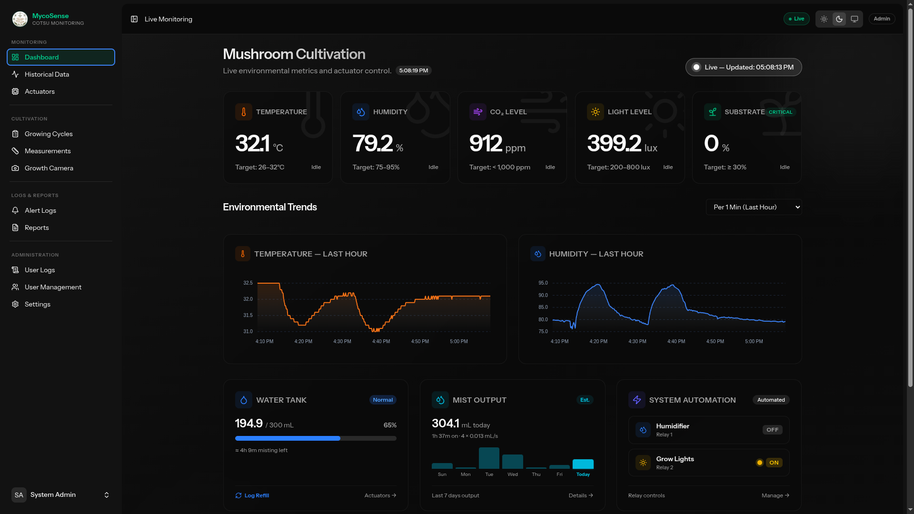
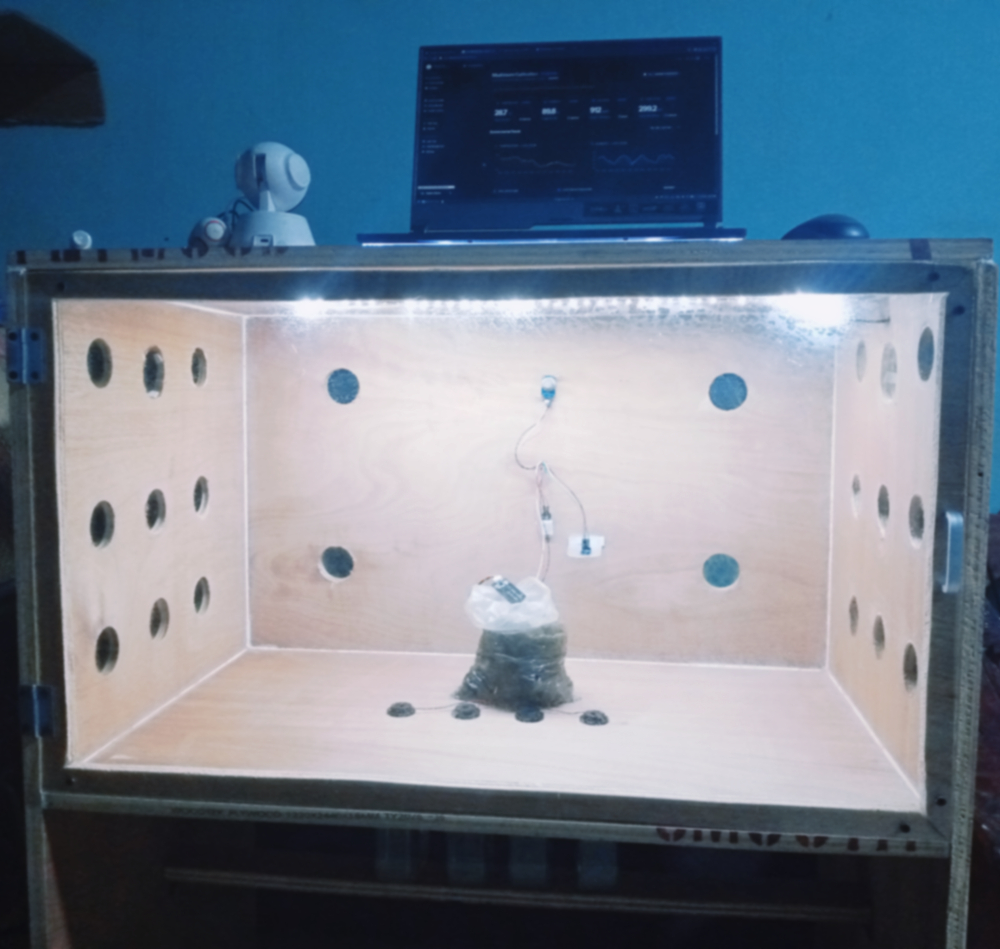

# IoT-Based Environmental Monitoring System for Oyster Mushroom Cultivation

An IoT system designed for monitoring and automating the cultivation environment of Gray Oyster Mushrooms (_Pleurotus ostreatus_). This system was developed for Cotabato State University — BS Agriculture Program.

The system uses an ESP32 microcontroller to collect environmental data from various sensors (temperature, humidity, CO2, light, and soil moisture) and automatically controls actuators (humidifier, grow light) based on specific thresholds. The data is sent to a Laravel backend, where it is stored in MySQL for historical tracking and pushed to a Firebase Realtime Database for live dashboard monitoring built with Vue.js.

## Preview




## System Architecture

```
ESP32 (sensors + actuators)
        │
        │ HTTP POST /api/sensor-data every 30 seconds
        ▼
Laravel API (SINGLE entry point — all data flows through here)
        │
        ├── Save to MySQL (permanent storage)
        └── Push latest values to Firebase (real-time dashboard)
                │
                ▼
        Vue.js Dashboard (via Inertia.js)
                │
                ├── Live sensor cards ← Firebase
                └── Historical charts ← MySQL via Laravel API
```

## Tech Stack

### Frontend

- **Framework**: Vue.js 3 (Composition API, `<script setup>`)
- **Routing**: Inertia.js v3
- **Styling**: Tailwind CSS v4
- **UI Components**: Reka UI + Lucide Icons (`@lucide/vue`)
- **Charts**: ApexCharts (`vue3-apexcharts`)
- **State Management**: Pinia
- **HTTP Client**: Axios
- **Notifications**: Vue Sonner
- **Real-time**: Firebase Realtime Database JS SDK
- **Language**: TypeScript

### Backend

- **Framework**: Laravel 13
- **Language**: PHP 8.4 above
- **Authentication**: Laravel Fortify
- **PDF Generation**: `barryvdh/laravel-dompdf`
- **SMS API**: Semaphore API (PH-based)
- **Task Scheduling**: Laravel Task Scheduler (`artisan schedule`)
- **File Storage**: Laravel Storage (Local disk, public)

### Database

- **Primary**: MySQL (Permanent data — readings, cycles, measurements, logs)
- **Real-time**: Firebase Realtime Database (Latest sensor values)

### Hardware

- **Microcontroller**: ESP32 WROOM-32U 38-pin (CP2102, Type-C)
- **Programming**: Arduino IDE / PlatformIO VSCODE extension (C++)
- **Communication**: HTTP POST to Laravel API (Every 30 seconds)

## Sensors & GPIO Pins

- **DHT22** (Temperature + Humidity) → GPIO 4
- **MQ-135** (CO2 / Air Quality) → GPIO 34
- **BH1750** (Light Level, I2C) → SDA: GPIO 21, SCL: GPIO 22
- **Capacitive Soil Moisture** → GPIO 35

## Actuators & Relay Channels

_All actuators use separate power rails — ESP32 only sends a relay signal. Relay is active LOW (LOW = ON, HIGH = OFF)._

- **Humidifier** (4 × Ultrasonic Mist Maker, wired together on one relay) → Relay N3 → GPIO 14
- **LED Grow Light Strip** (5V USB) → Relay N2 → GPIO 27

## Environmental Thresholds & Automation Logic

The system evaluates incoming sensor readings against a unified set of configurable **Environmental Thresholds** (customizable by Admin in **System Settings**):

| Environmental Factor      | Default Target Range       | Sensor     | System Automation & Alert Logic                                                              |
| :------------------------ | :------------------------- | :--------- | :------------------------------------------------------------------------------------------- |
| 🌡️ **Temperature**        | **26–32°C**                | DHT22      | `< 26°C` → Low temp SMS alert. `> 32°C` → High temp SMS alert (no auto-cooling).             |
| 💧 **Humidity**           | **75–95% RH**              | DHT22      | `<= 78%` → Auto-activate humidifier (SMS only if `< 75%`). `>= 94%` → Deactivate humidifier. |
| 🌬️ **CO₂ Level**          | **< 1,000 ppm**            | MQ-135     | `> 1,000 ppm` → High CO₂ SMS alert (ventilate chamber manually).                             |
| 💡 **Light Level**        | **200–800 lux** (Indirect) | BH1750     | `< 200 lux` → Alert too dim. `> 800 lux` → Alert too bright. LED runs on daily schedule.     |
| 🌱 **Substrate Moisture** | **≥ 30%**                  | Capacitive | `< 30%` → Warning (Dry) SMS alert. `< 20%` → Critical SMS alert.                             |

---

### ⚡ Actuator Interlock, Safety & Override Logic

- **Humidifier Failsafe Runtime & Stall Detection**:
    - Continuous humidifier operation is capped at **15 minutes** with a mandatory **3-minute resting cooldown**, protecting the ultrasonic mist makers from overheating if the reservoir runs dry.
    - If the humidifier runs continuously for **5 minutes** while humidity remains below the low threshold (`75%`), a **Stall Alert** SMS is sent to check the water tank, mist maker, and sensor.
- **Humidity Control Band**: The humidifier switches ON at _lower limit + 3_ (`78%`) and OFF at _upper limit − 1_ (`94%`, adjustable via `HUMIDIFIER_HUMIDITY_ON_MARGIN` / `HUMIDIFIER_HUMIDITY_OFF_MARGIN`), so humidity is corrected before leaving the target range. An SMS is sent only when humidity actually drops below the lower limit (`75%`).
- **Manual Override**: Faculty/Admin can manually lock any relay via the Actuator Control page. When a relay is locked, automation and schedules are paused for that specific relay.
- **Single Active Cycle & Smart SMS Alerts**: Only one growing cycle can be active at a time. When no cycle is active, dashboard sensor cards display an `Idle` state and environmental SMS alerts are suppressed so an empty chamber does not consume SMS credits.
- **Mist & Water Tank Tracking** (Dashboard & Actuator Control pages): Mist output and tank level are _estimates_ calculated from the humidifier relay's on-time in `actuator_logs` (not measured by a physical sensor).
    - Each of the 4 units is rated at 0.013 mL/s, so total output is 4 × 0.013 = 0.052 mL/s. Both the Dashboard and Actuator Control pages show today's total mist, a 7-day bar chart, and remaining tank capacity.
    - Each unit has its own tank (300 mL usable). After refilling **all** tanks, press **Log Refill** (on the Dashboard or Actuator Control page) — tank tracking starts from that moment (until then the card shows "Not tracking yet" and a full tank). Only the refill timestamp is stored (`settings.humidifier_tank_refilled_at`); the level is recomputed on every load.
    - An SMS ("Water Tank" in Alert Logs) is sent to Admin/Faculty when the tank drops to 10% or below while misting, repeated at most every 3 hours.
    - Tune via `.env`: `HUMIDIFIER_MIST_RATE`, `HUMIDIFIER_UNIT_COUNT`, `HUMIDIFIER_TANK_CAPACITY`, `HUMIDIFIER_LOW_TANK_PERCENT` (see `config/humidifier.php`).

## User Roles

- **Admin**: Full access — User management, settings, thresholds, and all logs.
- **Faculty**: Start/end cycles, log measurements, upload growth photos, control actuators, generate reports, and receive SMS alerts.
- **Student**: View dashboard, view growth documentation, view measurements (read-only — cannot log or delete), and analyze historical data.

## System Requirements

### Software Requirements

| Requirement        | Minimum Version | Notes                                                         |
| :----------------- | :-------------- | :------------------------------------------------------------ |
| **PHP**            | 8.4+            | PHP 8.5 recommended                                           |
| **Composer**       | 2.x             | PHP dependency manager                                        |
| **Node.js**        | 18.x LTS+       | Node 20 LTS recommended                                       |
| **npm**            | 9.x+            | Bundled with Node.js                                          |
| **MySQL**          | 8.0+            | MariaDB 10.6+ also compatible                                 |
| **Apache / Nginx** | Any recent      | Or use `php artisan serve` for local development              |
| **Git**            | 2.x+            | For cloning the repository                                    |
| **Arduino IDE**    | 2.x             | Or PlatformIO (VS Code extension) for ESP32 firmware flashing |

> **Recommended Setup**: [XAMPP](https://www.apachefriends.org/) (PHP 8.4+, MySQL 8) or [Laragon](https://laragon.org/) satisfies the Apache + MySQL + PHP stack in a single Windows installer.

---

### Host Machine Hardware Requirements

| Component   | Minimum             | Recommended                                                |
| :---------- | :------------------ | :--------------------------------------------------------- |
| **CPU**     | Dual-core 1.5 GHz   | Quad-core 2.0 GHz+                                         |
| **RAM**     | 4 GB                | 8 GB                                                       |
| **Storage** | 5 GB free           | 20 GB free (for growth photo uploads over multiple cycles) |
| **OS**      | Windows 10 (64-bit) | Windows 11 (64-bit)                                        |
| **Wi-Fi**   | 802.11n (2.4 GHz)   | 802.11ac or better                                         |

---

### Network Requirements

- The host machine and the **ESP32 must be on the same local Wi-Fi network** (same subnet / router) for the microcontroller's HTTP POST calls to reach the Laravel server.
- Laravel must be served with `--host=0.0.0.0` so it binds to the LAN interface, not just `localhost`.
- Outbound internet access is required for:
    - **Firebase Realtime Database** — real-time sensor value sync
    - **Semaphore SMS API** — push alerts to registered contacts
    - **Composer / npm** — pulling dependencies on first install

---

### Firebase Requirements

- A **Firebase project** with **Realtime Database** enabled (Spark plan is sufficient).
- A **service account** JSON key for server-side writes (Laravel backend).
- A **web app** registered in the Firebase project for client-side SDK config (Vue.js dashboard).
- Realtime Database rules must allow authenticated reads; unauthenticated writes are locked down — the Laravel service account bypasses rules via Admin SDK.

---

### ESP32 Firmware Dependencies (Arduino / PlatformIO)

| Library                         | Purpose                          |
| :------------------------------ | :------------------------------- |
| `DHT sensor library` (Adafruit) | DHT22 temperature + humidity     |
| `Adafruit Unified Sensor`       | Required by DHT library          |
| `BH1750` (Christopher Laws)     | Light level sensor (I2C)         |
| `ArduinoJson`                   | Serialize sensor payload to JSON |
| `WiFi.h`                        | Built-in ESP32 Wi-Fi stack       |
| `HTTPClient.h`                  | Built-in ESP32 HTTP client       |

> All libraries are available through the Arduino Library Manager or `platformio.ini` `lib_deps`.

---

## Setup & Installation (Windows)

1. **Clone the repository** (using Command Prompt, PowerShell, or Git Bash)

    ```bash
    git clone https://github.com/your-org/mushroom-monitoring-system.git
    cd mushroom-monitoring-system
    ```

2. **Install PHP dependencies**

    ```bash
    composer install
    ```

3. **Install Node dependencies**

    ```bash
    npm install
    ```

4. **Environment Configuration**

    In Command Prompt:

    ```cmd
    copy .env.example .env
    php artisan key:generate
    ```

    _(or `cp .env.example .env` in PowerShell / Git Bash)_

    _Update your `.env` file with the correct MySQL credentials, Firebase credentials, and Semaphore API key._

5. **Run Database Migrations & Seeders**

    ```bash
    php artisan migrate --seed
    ```

6. **Link Storage**

    ```bash
    php artisan storage:link
    ```

7. **Start Development Servers & System Services**

    To run the complete system with ESP32 hardware and automated schedules, open **3 separate Command Prompt or PowerShell terminals**:

    - **Terminal 1 — Laravel Server (LAN Listener)**

        ```cmd
        php artisan serve --host=0.0.0.0 --port=8080
        ```

        _Note: `--host=0.0.0.0` is required so the ESP32 on your Wi-Fi network can POST data._

    - **Terminal 2 — Vite / Frontend Compiler**

        ```cmd
        composer run dev
        ```

    - **Terminal 3 — Task Scheduler**

        ```cmd
        php artisan schedule:work
        ```

        _Note: Enforces actuator schedules (e.g., LED lights) every minute._

---

## 🍄 Operational Guide: Cold Start to Live Data

Follow these steps when powering up the physical mushroom monitoring setup:

1. **Start Database & Web Server (Apache & MySQL)**
    - Open **XAMPP Control Panel** (or Laragon) and click **Start** for **Apache** and **MySQL**.

2. **Verify Host IP Address**
    - Open Command Prompt or PowerShell:
        ```cmd
        ipconfig
        ```
    - Find the `IPv4 Address` under your connected Wi-Fi adapter (e.g., `192.168.254.xxx`).

    _If your host IP is not `192.168.254.138` (or the IP configured in your C++ code), update the endpoint URL in the ESP32 Arduino sketch and re-upload to the microcontroller._

3. **Start the 3 Required Terminals**
    - **Terminal 1 — Laravel API Server**: `php artisan serve --host=0.0.0.0 --port=8080`
    - **Terminal 2 — Composer Compiler**: `composer run dev`
    - **Terminal 3 — Task Scheduler**: `php artisan schedule:work`

4. **Access the Dashboard**
    - Open browser: `http://localhost:8080` (or `http://192.168.254.138:8080`)
    - Log in with your credentials.
    - After refilling the humidifier tanks, press **Log Refill** on the **Dashboard** or **Actuator Control** page so the water-tank tracker restarts.

5. **Power On ESP32**
    - Plug in the ESP32 board.
    - ESP32 connects to Wi-Fi (`GlobeAtHome_50B8D`).
    - MQ-135 sensor warms up for ~30 seconds.
    - Microcontroller begins posting readings every 10–30 seconds.
    - _(Optional)_ Monitor live status via Arduino IDE/PlatformIO Serial Monitor at **115200 baud**.

6. **Live Dashboard Verified ✅**
    - After ~35 seconds, the dashboard at `/dashboard` displays live temperature, humidity, CO₂, light, and substrate moisture metrics updated via Firebase.
